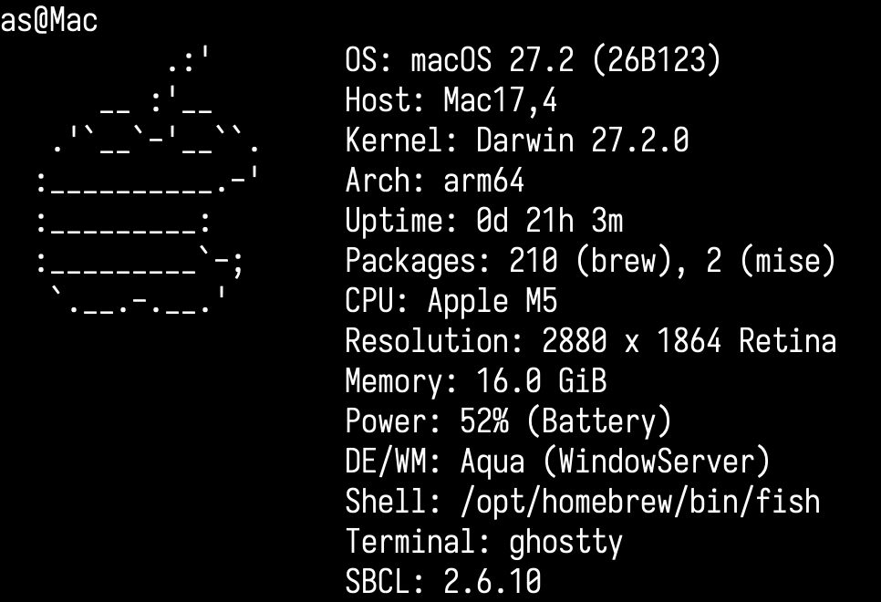

# lfetch

lfetch is a system information tool (like `neofetch`) written in Common Lisp.
It currently only supports MacOS.



Install sbcl, make `lfetch` executable and run:
```console
$ ./lfetch
```

# License

ISC © 2026 Aditya Singh <antichrome1@proton.me>
